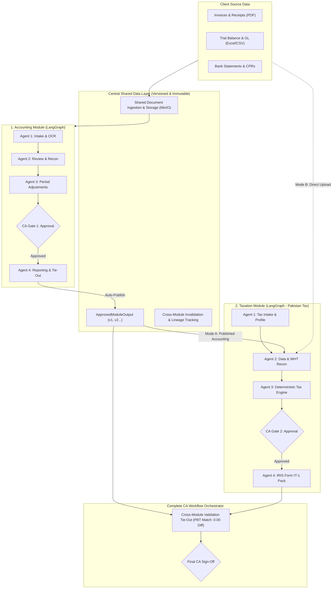

# Finora AI — Autonomous Multi-Agent CA Firm System

<div align="center">


**An AI-assisted Chartered Accountancy & Tax Advisory platform designed for CA firms to import, structure, review, reconcile, compute, and report on client financial records.**

[Features](#-key-features) • [Architecture](#-system-architecture) • [Multi-Agent Pipeline](#-multi-agent-ecosystem) • [Quick Start](#-quick-start) • [Repository Structure](#-repository-structure) • [Tech Stack](#-technology-stack)

</div>

---

## 📌 Executive Summary

**Finora** is an enterprise-grade Chartered Accountancy system built with a **modular multi-agent architecture**. In traditional CA practices, clients maintain their own accounting books and provide source files (Excel, CSV, digital and scanned PDFs). Finora automates the laborious tasks of document intake, OCR table extraction, cross-document reconciliation, period-end adjustments, statutory tax computations, and FBR IRIS filing packs—while keeping the Chartered Accountant firmly in control through **Human-in-the-Loop (HITL) approval gates**.

> **Core Architectural Boundary**: Finora reviews, reconciles, and reports on client source records. It does **not** create a general ledger or bookkeeping engine. Source files remain strictly immutable. All authoritative arithmetic uses pure Python `Decimal` services—never LLM guesswork.

---

## 🏛 System Architecture

Finora implements a **Hybrid State Architecture: Central Shared Data Layer + Separate Module States**.



### Key Architectural Pillars:
1. **Central Shared Data Layer**: Persistent repository managing verified taxpayer profiles, original documents, published outputs (`ApprovedModuleOutput`), and cross-module lineage.
2. **Versioned Dependency Invalidation**: When an accounting output updates (e.g., v1 → v2), dependent taxation runs are marked `is_outdated=True` with audit notices—never silently overwritten.
3. **Dual-Mode Tax Data Ingestion**:
   - **Mode A (Integrated)**: Consumes approved, published accounting outputs from the shared data layer.
   - **Mode B (Standalone)**: Operates independently on raw client accounting records when the accounting module has not yet run.
4. **Deterministic Calculation Services**: Arithmetic, tax rate brackets, Section 113 turnover tax, Section 113C ACT, and Section 4C Super Tax are calculated via pure Python `Decimal` logic with exact statutory audit traces.
5. **Future Audit Extensibility**: `AuditModuleState` schema and shared data contracts are pre-wired, allowing future Audit agents to integrate without modifying Accounting or Taxation.

---

## 🤖 Multi-Agent Ecosystem

### 📘 Module 1: Accounting (4 Agents)
- **Agent 1: File Intake & OCR Structuring** — Parses spreadsheets, digital PDFs, and scanned documents (via Tesseract OCR). Performs table detection, column role classification, date/amount normalization, and data-quality anomaly detection.
- **Agent 2: Accounting Review & Reconciliation** — Reconciles sales, purchases, cash/bank records, inventory, and payroll. Detects discrepancies, duplicates, and missing supporting documentation.
- **Agent 3: Period-End Adjustments** — Calculates accruals, prepayments, depreciation schedules (Straight Line, Reducing Balance), and prepares proposed adjusting journal entries.
- **Agent 4: Financial Statements & Validation** — Generates Adjusted Trial Balance, Balance Sheet, Profit & Loss Statement, and validates balance sheet tie-out equations before CA sign-off.

### 📗 Module 2: Pakistan Taxation (4 Agents)
- **Agent 1: Tax Intake & Taxpayer Profile** — Identifies taxpayer legal form, NTN, STRN, residential status, and active obligations under the Income Tax Ordinance 2001 and Sales Tax Act 1990 (CIT, WHT, Sales Tax, and Provincial Authorities: PRA, SRB, KPRA, BRA, ICT).
- **Agent 2: Tax Data & Reconciliation** — Ingests accounting outputs or raw client files, maps Trial Balance accounts to FBR tax workpaper categories, and reconciles withholding tax certificates (CPR) against GL deductions.
- **Agent 3: Tax Computation & Compliance (Deterministic Engine)** — Computes the complete Pakistan Book-to-Tax bridge:
  $$\text{Taxable Income} = \text{PBT} + \text{Inadmissible Expenses (s.21)} - \text{Admissible Deductions (s.22)}$$
  Compares statutory benchmarks (Normal CIT 29%, Minimum Tax s.113 @ 1.25%, Alternate Corporate Tax s.113C @ 17%, Super Tax s.4C graduated slabs) to determine authoritative tax payable.
- **Agent 4: Tax Review & Filing Pack** — Runs cross-check validations, maps figures to FBR IRIS Form IT-1 return schedule fields (codes 7001–7017), manages CA digital approval, and logs CPR filing evidence receipts.

---

## 🖥 Frontend Navigation & Experience

The user interface is designed with React 18, TypeScript, and Material UI, featuring a responsive sidebar with module-specific accent themes:

```
├── MAIN MENU
│   ├── 📊 Dashboard
│   └── 🏢 Companies & Clients
├── 1. ACCOUNTING MODULE (Indigo Accent)
│   ├── Accounting Dashboard
│   ├── 1. File Intake & OCR
│   ├── 2. Accounting Review
│   ├── 3. Period Adjustments
│   └── 4. Financial Statements & CA Sign-Off
├── 2. TAXATION MODULE (Emerald Accent)
│   ├── Taxation Dashboard (Engagement & Staleness Alert)
│   ├── 1. Tax Intake & Taxpayer Profile
│   ├── 2. Tax Data & Reconciliation
│   ├── 3. Tax Computation & Compliance
│   └── 4. Tax Review & Filing Pack
├── ORCHESTRATION (Sky Accent)
│   ├── 🔄 Complete CA Workflow (8-Step Stepper & Gate Controls)
│   ├── 🗄️ Shared Data & Documents (Version Lineage Browser)
│   └── ✅ Central Validation / Reports (Tie-Out Analyzer)
└── SYSTEM & SETTINGS
    ├── 🤖 AI Models & Routing (LiteLLM Gateway)
    └── 🛡️ Audit Logs
```

---

## 🛠 Technology Stack

| Layer | Technology | Purpose |
|---|---|---|
| **Frontend** | React 18, TypeScript, MUI v6, Vite | Type-safe, responsive CA workflow interface |
| **Backend API** | Python 3.12, FastAPI, Pydantic v2 | High-performance asynchronous REST API |
| **Agent Workflows** | LangGraph, LangChain Core | Cyclic multi-agent graphs with checkpointing |
| **Database** | PostgreSQL 16 + AsyncSQLAlchemy + Alembic | Relational data, audit trails, and multi-tenancy |
| **Object Storage** | MinIO (S3 Compatible) | Immutable document store for original client files |
| **LLM Gateway** | LiteLLM Proxy | Unified gateway for OpenAI, Claude, Gemini & local models |
| **Message Broker** | Apache Kafka (KRaft mode) | Asynchronous task processing and event envelope bus |
| **Caching & Locks** | Redis 7 | Distributed locking, session tokens, and rate limits |
| **Reverse Proxy** | Nginx | SSL termination, reverse proxy, and client routing |

---

## 🚀 Quick Start

### Prerequisites
- [Docker](https://www.docker.com/) and [Docker Compose](https://docs.docker.com/compose/) v2+
- Python 3.12+ and Node.js 20+ (for local host development)

### 1. Clone & Configure Environment
```bash
git clone https://github.com/hussnainali17/finora-ai.git
cd finora-ai/ca-firm-system

# Copy environment template
cp .env.example .env
```
> Edit `.env` to configure your database credentials, `JWT_SECRET`, and API keys for LiteLLM.

### 2. Run with Docker Compose
```bash
docker compose up --build
```

### 3. Service Endpoints

| Service | URL | Description |
|---|---|---|
| **Finora Web App** | `http://localhost:8080` | Main application UI (via Nginx) |
| **FastAPI Swagger Docs** | `http://localhost:8000/docs` | Interactive OpenAPI documentation |
| **MinIO Console** | `http://localhost:9001` | Object storage file manager |
| **LiteLLM Gateway** | `http://localhost:4000` | Multi-model AI gateway |

### 4. Bootstrap Firm & Admin User
```bash
docker compose exec -e BOOTSTRAP_ADMIN_PASSWORD='your-secure-password' backend \
  python -m app.cli bootstrap-firm \
  --firm-name "Finora Advisory Services" \
  --slug finora \
  --admin-email admin@finora.example \
  --admin-name "Principal CA"
```
Sign in at `http://localhost:8080` with the administrator credentials.

---

## 🧪 Testing & Verification

The system includes comprehensive test suites across all accounting, taxation, and orchestration workflows.

### Run Backend Tests (Pytest)
```bash
cd ca-firm-system/backend
$env:PYTHONPATH="."
python -m pytest tests/test_tax_intake.py tests/test_tax_data.py tests/test_tax_computation.py tests/test_tax_review.py tests/test_tax_workflow.py tests/test_complete_ca_workflow.py tests/test_shared_data.py tests/test_workflows.py tests/test_reporting.py -v
```
*(All 25 unit and integration tests passing)*

### Run Frontend Typecheck
```bash
cd ca-firm-system/frontend
npm run typecheck
```
*(Zero TypeScript errors)*

---

## 📂 Repository Structure

```
finora-ai/
├── README.md                                  # Repository overview (this file)
├── CA_Firm_System_Development_README.md       # Full roadmap and build specification
├── sample_general_ledger_run/                 # Sample client testing datasets
└── ca-firm-system/
    ├── docker-compose.yml                     # Multi-container orchestration
    ├── Makefile                               # Build and test shortcuts
    ├── backend/
    │   ├── app/
    │   │   ├── agents/                        # 4 Accounting Agents & 4 Taxation Agents
    │   │   │   ├── intake_agent/              # Agent 1: OCR & Data Structuring
    │   │   │   ├── accounting_review_agent/   # Agent 2: Accounting Anomaly & Recon
    │   │   │   ├── adjustments_agent/         # Agent 3: Period Adjustments
    │   │   │   ├── reporting_agent/           # Agent 4: Financial Statements
    │   │   │   ├── tax_intake_agent/          # Agent 1: Taxpayer Profile & Obligations
    │   │   │   ├── tax_data_agent/            # Agent 2: Tax Mapping & WHT Recon
    │   │   │   ├── tax_computation_agent/     # Agent 3: Deterministic Statutory Engine
    │   │   │   └── tax_review_agent/          # Agent 4: IRIS Form IT-1 Pack & Review
    │   │   ├── api/                           # FastAPI route endpoints
    │   │   ├── models/                        # SQLAlchemy database models
    │   │   ├── schemas/                       # Pydantic validation schemas
    │   │   ├── services/                      # Shared data, tax rules, and domain services
    │   │   ├── taxation/rules/                # Versioned Pakistan tax rate cards
    │   │   └── workflows/                     # LangGraph state graphs and orchestrators
    │   │       ├── coordination/              # Complete CA Workflow Orchestrator
    │   │       ├── states/                    # Independent module state schemas
    │   │       └── taxation/                  # Tax Workflow Orchestrator
    │   ├── migrations/                        # Alembic database migrations (0001 - 0013)
    │   └── tests/                             # Pytest test suites
    ├── frontend/
    │   ├── src/
    │   │   ├── app/                           # App routing and theme
    │   │   ├── components/navigation/         # Redesigned module-based Sidebar & Header
    │   │   ├── features/                      # Module views (accounting, taxation, orchestration)
    │   │   ├── services/                      # API client HTTP services
    │   │   └── types/                         # TypeScript interfaces
    ├── infrastructure/                        # Docker, Kafka, Nginx & LiteLLM configs
    └── workers/                               # Background Kafka event consumers
```

---

## 🔒 Security & Compliance

- **Immutable Audit Logging**: Every extraction, adjustment, calculation, and sign-off is cryptographically tracked with user IDs, timestamps, and session tokens.
- **Granular RBAC**: Fine-grained permissions (`tax:read`, `tax:manage`, `tax:approve`, `shared:read`, `shared:publish`, `report:sign_off`).
- **Data Isolation**: Multi-tenant architecture ensuring client records and workpapers remain isolated within each firm.
- **Original Source Integrity**: Uploaded files in object storage are read-only and never overwritten.

---

## 📄 License & Credits

Developed as a Final Year Project for Chartered Accountancy & Tax Automation.  
Built by [Hussnain Ali](https://github.com/hussnainali17).
